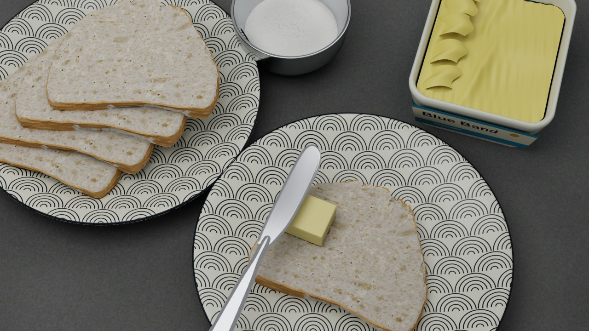

# 花纹餐盘场景的 Isaac 渲染

这是完整的三维餐桌场景：灰色石质台面、两只深蓝波纹餐盘、叠放面包、糖碗、打开的黄油盒，以及操作面包和银色抹刀。使用真实孔隙几何、纹理和灯光渲染，不使用参考照片作背景，也不把照片中的黄油涂层贴到面包上。



Genesis 负责物理仿真；Isaac 只回放已有的黄油表面、面包形变和刀具轨迹。所有渲染代码及必要资产位于本目录，不依赖其他示例或私有工程。渲染依赖为可选项，原有 Genesis 仿真入口无需安装 Isaac。

## 安装

使用独立的 Genesis 和 Isaac Python 环境，命令均在仓库根目录执行。

- **Genesis 环境**：按 [README](README.md) 安装本仓库，用于仿真、审计、表面重建、资产准备和视频验收。
- **Isaac 环境**：使用 Python 3.11、Isaac Sim 5.1.0 和兼容的 NVIDIA RTX GPU／驱动。版本固定用于复现参考，不代表最新推荐版本。安装方法见 [NVIDIA 官方说明](https://docs.isaacsim.omniverse.nvidia.com/5.1.0/installation/install_python.html)。

在独立的 Python 3.11 环境中运行：

```shell
python -m pip install --upgrade pip
python -m pip install -r examples/butter_spreading/requirements-isaac.txt
```

已有 Isaac 安装时，也可使用其 `python.bat` 或 `python.sh`，并安装清单中的 NumPy、SciPy、Numba、Pillow 和 imageio-ffmpeg。`carb`、`omni`、`pxr` 与 MDL 材质由 Isaac 提供，需在 `SimulationApp` 启动后使用。不要往 Isaac 环境安装整套 Genesis 依赖。

使用者需要自行接受 [NVIDIA Omniverse 许可协议](https://docs.omniverse.nvidia.com/platform/latest/common/NVIDIA_Omniverse_License_Agreement.html)。入口不会自动接受；已接受者可为当前渲染进程设置 `OMNI_KIT_ACCEPT_EULA=YES`，例如 PowerShell 中 `$env:OMNI_KIT_ACCEPT_EULA='YES'`。

面包原始网格、MIT 许可和所需纹理已随仓库提供，不需要 Blender、联网下载模型或运行其他项目。资产来源见 [render_assets/NOTICE.md](render_assets/NOTICE.md)。

## 完整运行

**1. 在 Genesis 环境中生成完整轨迹。** 已有合格的完整流水线结果可跳过。

```shell
python -m examples.butter_spreading.pipeline --config examples/butter_spreading/configs/dataset.json --output-dir out/spreading
```

**2. 在 Genesis 环境中准备渲染目录。**

```shell
python -m examples.butter_spreading.prepare_isaac --source out/spreading --output-dir out/spreading-kitchen
```

准备程序要求完整轨迹和物理审计通过，核对轨迹与表面哈希。它复制物理结果和纹理，从自带的原始网格生成约 302 万顶点的多孔面包外观，并记录全部输入哈希。输出目录必须为空。准备后的整个目录可传输到另一台安装了本仓库和 Isaac 的机器运行。

**3. 在 Isaac 环境中渲染。**

```shell
# 完整餐桌视角，默认 1280×720、24 fps、64 samples。
python -m examples.butter_spreading.render_isaac --run out/spreading-kitchen

# 可选：操作面包近景。
python -m examples.butter_spreading.render_isaac --run out/spreading-kitchen --camera bread
```

如需先检查一帧：

```shell
python -m examples.butter_spreading.render_isaac --run out/spreading-kitchen --frames 1
```

短预览不能替代完整视频验收。完整基准输出 97 帧，覆盖四秒动作，包括 4.00001 s 的离散终点。渲染拒绝覆盖同名输出；重新调参时准备新目录。可通过 `--samples` 调节采样数，增大可减少噪声但更慢；`--width`、`--height` 必须为正偶数。`--start-frame` 和 `--frames` 可选取片段，`--gui` 打开窗口。默认使用 PathTracing，参考效果以该模式为准。

**4. 在 Genesis 环境中验收。**

```shell
python -m examples.butter_spreading.validate_isaac --run out/spreading-kitchen
python -m examples.butter_spreading.validate_isaac --run out/spreading-kitchen --camera bread
```

第二条只用于已渲染完整近景视频的情况。验收检查输入哈希、完整帧数、源时间、视频时间戳、尺寸、帧率、黑帧，以及刀具／黄油读回误差、面包变形雅可比和背景实例状态。人工仍需检查画面质量。默认物理参数和轨迹在渲染阶段不会修改。

## 输出

| 文件 | 内容 |
| --- | --- |
| `mpm-state.*`、`mpm-surface.*` 及审计文件 | 复制的 Genesis 轨迹和黄油表面 |
| `render-assets/` | 可移植纹理、生成的面包外观网格及许可 |
| `isaac-inputs.json` | 准备耗时和所有渲染输入的哈希 |
| `isaac-scene.mp4` | 完整餐桌视角视频 |
| `isaac-bread.mp4` | 可选的操作面包近景视频 |
| `isaac-scene-frame-*.png` | 首、中、末代表帧 |
| `isaac-scene.json` | 源轨迹、采样参数、场景检查与面包形变记录 |
| `isaac-scene.timing.json` | 初始化、形变、几何更新、绘制、编码和场景导出的分段耗时 |
| `isaac-scene.usdc` | 最后一帧静态场景，不是动画缓存；检查材质时需保留纹理目录 |
| `isaac-scene-validation.json` | 视频验收结果 |

近景文件使用 `isaac-bread` 前缀；片段名称带起始帧和请求帧数。USD 中的纹理路径对应生成场景时的位置；跨机器传输后，重新运行渲染以重建路径。Isaac 关闭可能直接终止解释器，因此计时文件在关闭前写入，并通过 `shutdown_included` 标明是否包含关闭耗时。

## 几何和外观约定

- 单位米、Z 向上。操作面包、黄油和刀具放在同一个绕 Z 轴旋转 −24° 的任务组内；源轨迹本身不旋转或重新积分。场景旋转只用于视觉布局。
- 操作面包使用固定的多孔外观网格，通过材料坐标的三线性粒子位移插值逐帧变形，位移增益为 1，边界允许半格外推。法线使用变形梯度的逆转置更新；非有限值或翻转会报错。网格细孔不代表求解器独立求解了每个孔洞。
- 操作面包解除共享实例，背景四片面包保持共享静态原型，避免全部跟着变形。几何归一化尺寸为 0.14×0.114×0.016 m，顶面位于任务坐标 Z=0.026 m；接入不同尺寸的物理面包时必须同步适配归一化和位置。
- 可见抹刀是 1.2 mm 薄刀面和带柄外观，其下表面对齐记录的物理刀具代理下表面。外观轮廓不等于轴对齐碰撞盒；没有重新计算接触。接入任意刀具旋转或替换刀具资产时，应扩展位姿映射和检查。
- 动态黄油使用原样重建表面，UsdPreviewSurface 颜色 `(0.83, 0.73, 0.34)`、粗糙度 `0.40`；不追加人造刀面薄膜。面包使用 OmniSurface 透光／散射和真实孔隙表面，餐盘、台面、刀面使用对应纹理。黄油盒里的黄油是静态背景道具。
- 环境光强度 260，主面积光 1850，窗口反射光 1400；相机焦距 59、横向孔径 36。参数是该场景的外观设置，不是实测黄油光学常数。场景构图与灯光在 `render_isaac.py`，布局在 `kitchen_scene.py`，面包与刀具外观在 `bread_knife_assets.py`。

更改几何、相机、材质或轨迹后，应重新准备独立目录并保存一套对应的验收结果。所需渲染依赖独立列在本示例中，不加入仓库全局依赖。

## 回归测试

```shell
python -m pytest -n 0 tests/particles/test_butter_spreading_render.py
```

该测试不启动 Isaac，检查材料坐标插值、压缩／剪切、法线变换、无逐帧累积漂移和翻转拒绝。修改渲染路径还需运行完整视频并验收。
