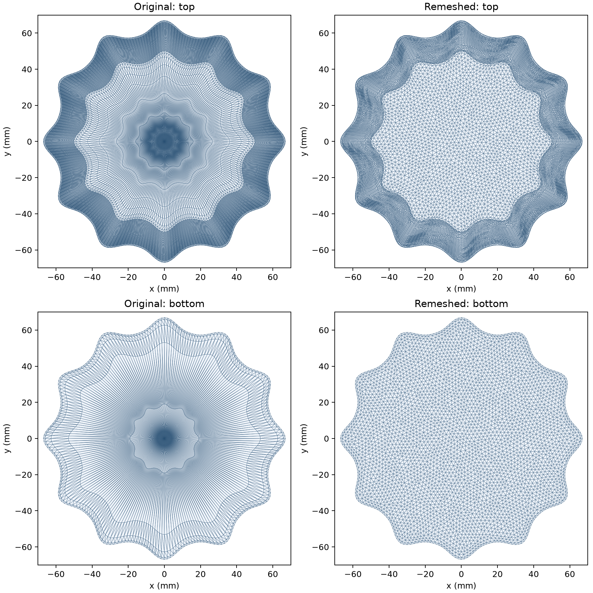

# Jelly simulation surface

[remeshed.obj](remeshed.obj) is the shared surface for the jelly shell, vertex block descent (VBD) solid, and finite element method (FEM) with incremental potential contact (IPC) examples. Coordinates are in meters with Z up. Examples translate the lowest vertex to 0.015 m before building the scene.

The source is [jelly.glb](jelly.glb), node `Jelly_Fluted_12Lobes`, with its scene transform applied. The source GLB retains its authored geometry. The simulation surface contains the closed jelly exterior; decorative bubbles belong to the source scene.

Regenerate the asset and [quality.json](quality.json) from the repository root:

```powershell
python examples/vbd/vbd_remesh.py
```

The generator uses PyMeshLab isotropic explicit remeshing with a 2 mm target edge length, 15 iterations, surface reprojection, and a 0.1 mm local surface-distance limit. That local limit is an operation constraint; measured global sampled deviation is reported separately. [PyMeshLab filter documentation](https://pymeshlab.readthedocs.io/en/latest/filter_list.html#meshing-isotropic-explicit-remeshing).

| Surface measurement | Original | Remeshed |
| --- | ---: | ---: |
| Vertices | 13,442 | 12,740 |
| Triangles | 26,880 | 25,476 |
| Minimum triangle angle | 0.819 degrees | 17.297 degrees |
| 1st percentile minimum triangle angle | 0.971 degrees | 33.292 degrees |
| Triangles with minimum angle below 5 degrees | 2,160 | 0 |

Both surfaces pass watertightness, consistent winding, and self-intersection checks. The relative enclosed-volume change is +0.00422%. The maximum bidirectional vertex-and-face-center sampled distance is 0.180 mm; this is a sampled comparison, rather than a certified Hausdorff bound.

For the offline TetGen quality check, the minimum tetrahedral mean ratio improves from 0.0000782 to 0.0888, and its 1st percentile from 0.0215 to 0.3756. This dimensionless measure is `12 * (3 * volume)^(2/3) / sum(edge_length^2)` and equals 1 for a regular tetrahedron. All initial tetrahedral volumes are positive. The example tetrahedralizes after translating the surface; floating-point differences can change the interior triangulation, so the actual simulation counts are recorded in each run's JSON.

The quality report records source and output SHA-256 hashes, tool versions, and tetrahedralization settings. Simulation reports also record the asset hash. The benchmark records in `examples/vbd/results/` that predate this asset describe the original GLB mesh.

The [simulation validation](../../../../examples/vbd/results/remesh_validation.json) records 200-frame GPU drop runs at 10,000 and 100,000 Pa for both solvers. All remeshed runs have positive tetrahedral volumes at every sampled frame. At 10,000 Pa the original-mesh IPC control retains 293 inverted tetrahedra at the final frame; see the [render comparison](../../../../examples/vbd/results/remesh_ipc_comparison.png). These checks cover the recorded drop settings and frame samples.


